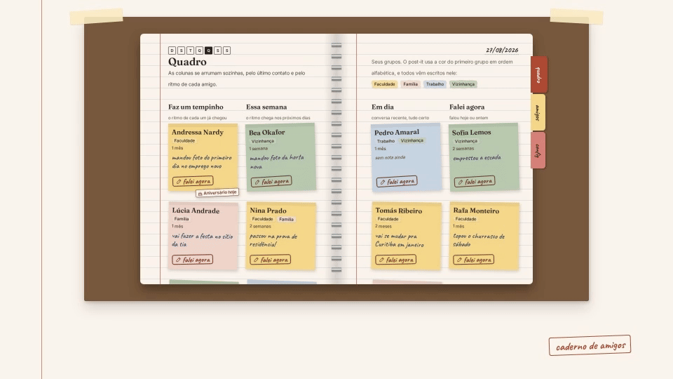

# Caderno de amigos

[](https://github.com/stephanto-dev/caderno-de-amigos/actions/workflows/ci.yml)

Um CRM pessoal com cara de caderno, feito para lembrar de falar com os amigos.
Não é um painel de vendas: não tem placar, não tem "atrasado" em vermelho, não tem culpa.



[Assista ao vídeo completo (35 s)](docs/media/crm-promo.mp4). O vídeo e o GIF usam só dados de demonstração.

## Por que existe

Dá para gostar dos amigos e mesmo assim não puxar conversa. Com o tempo a gente
esquece há quanto tempo não fala com alguém e o que estava rolando na vida da pessoa.
O caderno guarda isso e mostra, com calma, quem seria bom chamar agora e qual foi
o último assunto registrado.

O projeto tem dois objetivos:

1. **Uso pessoal.** Manter contato com os amigos no dia a dia. Só vira produto
   se o uso mostrar valor.
2. **Aprendizado.** Praticar Django e Python de perto, com decisões registradas
   e entregas pequenas e verificáveis.

## O que ele faz

- **Cadastro simples.** Dá para começar preenchendo só o nome: o ritmo já vem
  como "falar a cada 1 mês" e pode ser ajustado depois.
- **"Falar a cada"**: cada amigo tem seu próprio ritmo de contato (dias, semanas,
  meses ou anos).
- **Quadro de post-its** em quatro colunas: "Faz um tempinho", "Essa semana",
  "Em dia" e "Falei agora", calculadas a partir do último contato e do ritmo
  escolhido. Cada post-it tem o botão "falei agora".
- **Registrar contato** (mensagem, ligação ou encontro) com uma nota rápida,
  que aparece em destaque no cartão do amigo.
- **Grupos opcionais** com cor de uma paleta fixa. Um amigo pode estar em vários.
- **Conta própria** com e-mail e senha, numa capa de caderno fechado. Cada conta
  tem seus próprios amigos, grupos e contatos.
- **Desktop e celular**, com layouts adaptados a cada tela e atalhos de teclado
  no registro de contato.

Fora do MVP: notificações por e-mail ou push, integração com WhatsApp, sugestão
de mensagem por IA e recuperação de senha.

## Stack

- **Backend:** Python 3.11+, Django 5, Django REST Framework e PostgreSQL 16.
- **Frontend:** Vue 3 (SPA), TypeScript, Vite e Tailwind CSS.
- **Deploy:** arquitetura prevista para um único container Docker no Coolify.
  Gunicorn e WhiteNoise servem a API Django e o frontend compilado na mesma
  origem. O PostgreSQL roda num serviço separado.
- **Testes:** pytest + pytest-django com PostgreSQL real e Vitest no frontend.
- **Qualidade:** Ruff, mypy e vue-tsc; dependências Python com `uv`.

## Estrutura

```text
backend/   API Django (código em backend/src)
frontend/  App Vue
design/    Identidade visual, spec de telas, tokens e protótipos
docs/      Arquitetura, ADRs e guias de engenharia
```

O código, os nomes da API e do banco são em inglês. A interface é em português.

## Desenvolvimento

Instale Git e Docker com o plugin Compose. Na primeira execução, o Docker baixa
as imagens e instala as dependências; Python e Node não precisam estar
instalados na máquina para usar esse caminho.

```sh
git clone https://github.com/stephanto-dev/caderno-de-amigos.git
cd caderno-de-amigos
cp .env.example .env
docker compose up --build
```

O `.env.example` contém somente valores fictícios de desenvolvimento. A cópia
`.env` não entra no Git. O backend também aceita `.env.local` para sobrescrever
valores só na máquina local; variáveis do processo têm prioridade sobre ambos.
O Compose lê `.env` e define o endereço do banco dentro dos containers.

O Compose inicia PostgreSQL, Django (`http://localhost:8000`) e Vite (`http://localhost:5173`).
Durante o desenvolvimento, abra o app em `http://localhost:5173`: mudanças em
Vue e CSS aparecem ao salvar, e o Vite repassa `/api` ao Django. Mudanças em
Python também são recarregadas pelo Django. Não é preciso reconstruir a imagem
ao salvar código; reconstrua quando mudar dependências ou o Dockerfile.

As portas do PostgreSQL, Django e Vite são publicadas somente em `127.0.0.1`.
O acesso por `localhost` continua funcionando; outros computadores da rede
não devem acessar esses serviços pelo IP da máquina. Essa configuração depende
do comportamento de publicação do Docker: use Docker Engine 28 ou mais recente,
pois versões anteriores têm uma [falha conhecida no isolamento de portas locais](https://docs.docker.com/engine/network/port-publishing/).
Depois de atualizar um checkout já em execução, aplique os novos bindings com
`docker compose up -d --force-recreate`. Esse comando recria os containers e
interrompe brevemente conexões existentes, mantendo os volumes de dados.

Na tela inicial em `http://localhost:5173`, escolha **Criar conta**. O banco
começa sem amigos ou contas de demonstração. Para acessar o Django Admin, crie
um superusuário separadamente:

```sh
docker compose exec web python src/manage.py createsuperuser
```

O admin fica em `http://localhost:8000/admin/` e permite acesso global aos dados;
use a conta comum para utilizar o CRM. Para parar os serviços, use
`docker compose down`. Os dados permanecem no volume do PostgreSQL.

### Variáveis de ambiente

Os valores abaixo são os exemplos locais de [`.env.example`](.env.example).
As credenciais são públicas e servem apenas para o banco de desenvolvimento.

| Variável | Exemplo local | Para que serve |
| --- | --- | --- |
| `DJANGO_DEBUG` | `1` | Liga a depuração local; o padrão do backend é `0`. |
| `DJANGO_TRUST_X_FORWARDED_PROTO` | `0` | Confia no protocolo informado pelo proxy somente quando configurado e verificado. |
| `DJANGO_SECRET_KEY` | `development-only-secret-key` | Chave fictícia local; produção exige uma chave aleatória exclusiva. |
| `DJANGO_ALLOWED_HOSTS` | `localhost,127.0.0.1` | Hosts aceitos pelo Django, separados por vírgula. |
| `DJANGO_TRUSTED_PROXY_COUNT` | `0` | Quantidade de proxies confiáveis usada na identificação do IP para os limites de requisições. |
| `POSTGRES_DB` | `caderno` | Nome do banco. |
| `POSTGRES_USER` | `caderno` | Usuário do banco. |
| `POSTGRES_PASSWORD` | `caderno` | Senha fictícia local, recusada pelo Django em produção. |
| `POSTGRES_HOST` | `localhost` | Endereço do banco; o Compose usa `db` dentro do container. |
| `POSTGRES_PORT` | `5433` | Porta publicada na máquina; o Compose usa `5432` entre containers. |

### Testes e verificações

Para rodar os testes Python na máquina, instale Python 3.11+ e `uv` e mantenha
o banco local ligado com `docker compose up -d db`. A partir da raiz:

```sh
cd backend
uv sync --frozen
uv run ruff check src
uv run ruff format src --check
uv run mypy --config-file pyproject.toml src
uv run python src/manage.py check
uv run python src/manage.py makemigrations --check --dry-run
uv run pytest src
```

Os testes usam um banco de testes separado. O usuário do PostgreSQL precisa
de permissão para criá-lo; o usuário local criado pelo Compose já tem essa
permissão. Nunca aponte os testes para um banco de produção.

Para o frontend, instale Node.js 22 e rode, a partir da raiz:

```sh
cd frontend
npm ci
npm run typecheck
npm test
npm run build
```

O CI verifica backend, frontend e a construção da imagem Docker. Para conferir
a imagem localmente, use `docker build -t caderno-de-amigos .` na raiz.

## Produção

Use a imagem Docker com Gunicorn. O Compose é exclusivo de desenvolvimento:
ele liga o modo de depuração e usa `runserver`. A imagem serve o frontend
compilado junto com o Django; o PostgreSQL continua separado.

Ao iniciar, o container executa `migrate --noinput` antes de iniciar o Gunicorn.
Isso aplica migrations pendentes em cada deploy e também nos reinícios. Se a
migration falhar, o servidor não inicia; consulte os logs do deploy para corrigir
o erro. Não é necessário configurar outro comando de migration no Coolify.
Esse fluxo pressupõe uma única instância iniciando por vez; ao adicionar réplicas,
execute migrations em uma etapa única de publicação. Faça backup do banco antes
de publicar mudanças de schema.

Configure `DJANGO_DEBUG=0`, `DJANGO_SECRET_KEY`, `DJANGO_ALLOWED_HOSTS`,
`POSTGRES_DB`, `POSTGRES_USER`, `POSTGRES_PASSWORD` e `POSTGRES_HOST`.
O modo de depuração fica desligado por padrão; só o ambiente local deve usar
`DJANGO_DEBUG=1`. Não reutilize o `.env.example` como configuração de produção.

O servidor recusa chaves com menos de 50 caracteres, menos de 5 caracteres
diferentes ou com prefixo `django-insecure-`. Também recusa a senha de banco
`caderno` e a ausência de domínios explícitos. `DJANGO_ALLOWED_HOSTS` não aceita `*` em
produção. Esses critérios para a chave são uma verificação mínima; gere uma
chave aleatória exclusiva com `python -c 'import secrets; print(secrets.token_urlsafe(64))'`
e guarde-a somente no ambiente da hospedagem. Defina uma senha exclusiva também
no PostgreSQL antes de iniciar o app.

Fora do modo local, o Django redireciona HTTP para HTTPS e marca os cookies de
sessão e CSRF como `Secure`. O cookie de sessão continua `HttpOnly`, e ambos
continuam com `SameSite=Lax`. O Vue precisa ler o cookie CSRF para montar o
cabeçalho das requisições; esse cookie permanece acessível ao JavaScript.

Configure o certificado e o acesso HTTPS na hospedagem antes de abrir o app.
Se um proxy termina o HTTPS e encaminha HTTP para o Django, ative
`DJANGO_TRUST_X_FORWARDED_PROTO=1` somente depois de verificar que esse proxy
sobrescreve `X-Forwarded-Proto` e que ninguém pode acessar o backend diretamente.
O default `0` ignora esse cabeçalho. Sem o ajuste em um proxy que encaminha
HTTP, haverá redirecionamentos repetidos; não desative as proteções para contornar isso.

Respostas HTTPS incluem HSTS por uma hora, apenas para o domínio acessado,
sem `includeSubDomains` nem `preload`. Não publique o app nesse domínio sem
HTTPS funcional, pois o navegador vai exigir HTTPS durante esse período.
Com as variáveis reais de produção, execute
`python src/manage.py check --deploy` em `backend/` antes do deploy. Os avisos
sobre `includeSubDomains` e `preload` ficam pendentes até confirmar HTTPS para
os demais subdomínios; não habilite essas opções só para remover os avisos.

## Limites de requisições

Login e cadastro têm, cada um, limite de 5 tentativas por minuto por IP, mesmo
quando a sessão muda. Amigos, grupos e contatos compartilham o limite de
60 requisições por minuto por usuário autenticado.

`DJANGO_TRUSTED_PROXY_COUNT=0` usa o IP da conexão e ignora `X-Forwarded-For`.
Na hospedagem, ajuste esse valor à quantidade de proxies confiáveis na frente
do Django somente depois de verificar a cadeia. Eles precisam remover ou
normalizar cabeçalhos enviados pelo cliente, e o backend não pode aceitar
conexões públicas que contornem esses proxies. Por exemplo, use `1` quando
existir um único proxy confiável que acrescente o IP real ao final do cabeçalho.
Não presuma que Cloudflare junto com outro proxy terá essa mesma configuração.

Sem esse ajuste, usuários atrás de um proxy compartilham o contador pelo IP
dele. Pessoas na mesma rede também podem compartilhar um IP e o mesmo limite.
Os contadores atuais ficam na memória de cada processo e somem ao reiniciar.
Antes de usar vários workers ou réplicas, será preciso compartilhar os
contadores. O throttle do DRF não garante proteção contra força bruta ou
ataques de volume; regras na borda, como no Cloudflare, complementam esses
limites e precisam ser configuradas e verificadas na hospedagem.

## Documentação

- [Arquitetura do sistema](docs/arquitetura.md)
- [ADRs (registros de decisões de arquitetura)](docs/ADL.md)
- [Guias de engenharia](docs/engineering/README.md)
- [Design: identidade e spec](design/README.md)
- [Como contribuir](CONTRIBUTING.md)
- [Código de conduta](CODE_OF_CONDUCT.md)
- [Como reportar vulnerabilidades](SECURITY.md)

## Licença

Distribuído sob a [licença MIT](LICENSE). A licença do código não autoriza
o acesso a dados privados de usuários.
