# Arquitetura do Caderno de Amigos

Visão geral da arquitetura do sistema.

## O que roda onde

### Produção (Coolify)

**Serviço único** com imagem Docker multi-stage ([ADR 2026-10-20](ADRs/2026-10-20-servico-unico-docker.md)):
- **Stage 1 (build)**: Node compila o frontend Vue com Vite
- **Stage 2 (runtime)**: Python serve a API Django + arquivos estáticos via WhiteNoise
- Frontend e backend na mesma origem (sem CORS)

**Postgres**: serviço separado no Coolify com backup diário para Cloudflare R2 ([ADR 2026-10-20](ADRs/2026-10-20-backup-postgres-coolify.md))

### Desenvolvimento local

- `docker compose up`: sobe Postgres e Django
- `npm run dev`: Vite dev server com proxy de `/api` para Django

## Stack

- **Backend**: Django, Django REST Framework, Python
- **Frontend**: Vue 3, TypeScript (strict), Vite, Tailwind CSS
- **Banco**: PostgreSQL
- **Deploy**: Coolify (self-hosted)
- **Testes**: pytest + pytest-django (backend), Vitest (frontend)
- **Qualidade**: ruff, mypy, vue-tsc

## Modelo de dados

### Friend

Pessoa com quem o usuário quer manter contato.

Campos principais:
- `name`: string
- `cadence_amount`: inteiro positivo (mínimo 1)
- `cadence_unit`: TextChoices (day, week, month, year)
- `groups`: ManyToMany para `Group` (opcional)
- `owner`: ForeignKey para User

Sem campo `last_contact_at` — esse campo é calculado (derivado via `Max("contacts__date")`) ([ADR 2026-10-20](ADRs/2026-10-20-coluna-quadro-calculada.md))

### Contact

Registro de interação com um amigo.

Campos principais:
- `friend`: ForeignKey com `on_delete=CASCADE`
- `date`: DateTimeField (UTC, interpretado como São Paulo) ([ADR 2026-10-20](ADRs/2026-10-20-datas-utc-timezone-sao-paulo.md))
- `kind`: TextChoices (message, call, meeting)
- `note`: TextField (opcional)

Índice em `(friend, date)` para performance.

### Group

Organização opcional de amigos.

Campos principais:
- `name`: string (único por owner sem diferenciar maiúsculas — planejado em CRM-7)
- `color`: TextChoices (family, college, work, neighborhood, neutral)
- `owner`: ForeignKey para User

Relacionamento N:N com `Friend` ([ADR 2026-10-20](ADRs/2026-10-20-modelo-dados-ritmo-tipo-grupos.md))

## API REST

Autenticação por sessão Django com CSRF ([ADR 2026-10-20](ADRs/2026-10-20-autenticacao-por-sessao.md))

### Autenticação
- `POST /api/login/` — cria sessão
- `POST /api/logout/` — invalida sessão
- `GET /api/me/` — verifica autenticação, seta o cookie csrftoken, retorna `{"authenticated": true|false, "user": "username"|null}`

### Friends
- `GET /api/friends/` — lista amigos do usuário, já ordenada pelo backend (por coluna e urgência), com `column` calculada, último contato, grupos
- `POST /api/friends/` — cria amigo
- `GET /api/friends/{id}/` — detalhe
- `PATCH /api/friends/{id}/` — edita
- `DELETE /api/friends/{id}/` — remove

### Contacts (nested routes)
- `POST /api/friends/{id}/contacts/` — registra contato (retorna amigo atualizado)
- `DELETE /api/friends/{id}/contacts/{contact_id}/` — desfaz contato

### Groups
- `GET /api/groups/` — lista grupos do usuário (com `friends_count`)
- `POST /api/groups/` — cria grupo
- `PATCH /api/groups/{id}/` — edita grupo
- `DELETE /api/groups/{id}/` — remove grupo (desvincula amigos, nunca exclui amigos)

Detalhes completos em [ADR 2026-10-20](ADRs/2026-10-20-contrato-api-mvp.md)

## Quadro (dashboard principal)

O Quadro mostra amigos em 4 colunas baseadas no tempo desde o último contato e no ritmo desejado:

1. **`just_talked`** ("Falei agora") — última interação foi hoje ou ontem
2. **`overdue`** ("Faz um tempinho") — passou do ritmo desejado
3. **`this_week`** ("Essa semana") — dentro dos últimos 7 dias do ritmo (janela fixa) ([ADR 2026-10-20](ADRs/2026-10-20-quadro-simplificado-janela-fixa.md))
4. **`on_track`** ("Em dia") — dentro do ritmo, com mais de 7 dias restantes

A coluna é **calculada no backend** por `BoardService` ([ADR 2026-10-20](ADRs/2026-10-20-coluna-quadro-calculada.md)). O frontend apenas agrupa e renderiza.

## Diagrama de arquitetura

```mermaid
graph TB
    subgraph "Cliente (Browser)"
        Vue[Vue 3 SPA<br/>TypeScript Strict]
    end

    subgraph "Servidor (Coolify)"
        subgraph "Container Django"
            WN[WhiteNoise<br/>Arquivos estáticos]
            API[Django REST API<br/>SessionAuth + CSRF]
            Services[Services<br/>BoardService<br/>FriendsService]
        end
        DB[(PostgreSQL)]
        Backup[Backup diário<br/>Cloudflare R2]
    end

    Vue -->|GET /static/*| WN
    Vue -->|POST/GET /api/*<br/>Cookie + CSRF| API
    API --> Services
    Services --> DB
    DB -.->|pg_dump daily| Backup

    style Vue fill:#42b883
    style API fill:#092e20
    style Services fill:#0c4b33
    style DB fill:#336791
    style Backup fill:#f38020
```

## Princípios arquiteturais

### Régua de simplicidade ([ADR 2026-10-20](ADRs/2026-10-20-regua-simplicidade.md))

Toda decisão passa por: **se dá para fazer com menos regra, menos estado ou menos biblioteca, faz assim**.

### Services concentram a lógica ([docs/engineering](engineering/README.md))

Views e serializers são finos. A lógica de negócio vive em services:
- `BoardService.calculate_column(friend, last_contact)` — determina a coluna no Quadro
- `BoardService.get_cadence_in_days(friend)` — converte cadência para dias
- `FriendsService(friends_for_owner, owner).list_friends()` — lista amigos ordenados com dados computados do board
- `ContactsService(owner)` — planejado: `record_contact` e `undo_contact`

### TDD obrigatório ([ADR 2026-10-20](ADRs/2026-10-20-estrategia-testes-tdd.md))

Teste antes do código. Backend com pytest, frontend com Vitest.

### Sem complexidade prematura ([ADR 2026-10-20](ADRs/2026-10-20-sem-cache-fila-worker-mvp.md))

MVP sem Redis, Celery, RabbitMQ ou email. Adiciona-se quando necessário, não "por precaução".

## Fora do MVP

- Email ou push de lembretes ([ADR 2026-10-16](ADRs/2026-10-16-sem-email-lembretes-mvp.md))
- Histórico completo de contatos
- Multiusuário (campos `owner` já existem)
- Testes E2E com navegador
