# Arquitetura do Caderno de Amigos

Visão geral da arquitetura do sistema.

## O que roda onde

### Produção (Coolify)

**Serviço único** com imagem Docker multi-stage ([ADR 0001](ADRs/0001-servico-unico-docker.md)):
- **Stage 1 (build)**: Node compila o frontend Vue com Vite
- **Stage 2 (runtime)**: Python serve a API Django + arquivos estáticos via WhiteNoise
- Frontend e backend na mesma origem (sem CORS)

**Postgres**: serviço separado no Coolify com backup diário para Cloudflare R2 ([ADR 0012](ADRs/0012-backup-postgres-coolify.md))

### Desenvolvimento local

- `docker compose up`: sobe Postgres e Django
- `npm run dev`: Vite dev server com proxy de `/api` para Django

## Stack

- **Backend**: Django 5, Django REST Framework, Python 3.11+
- **Frontend**: Vue 3, TypeScript (strict), Vite, Tailwind CSS
- **Banco**: PostgreSQL
- **Deploy**: Coolify (self-hosted)
- **Testes**: pytest + pytest-django (backend), Vitest (frontend)
- **Qualidade**: ruff, mypy --strict, vue-tsc

## Modelo de dados

### Amigo

Pessoa com quem o usuário quer manter contato.

Campos principais:
- `nome`: string
- `ritmo_quantidade`: inteiro positivo
- `ritmo_unidade`: TextChoices (dia, semana, mês, ano)
- `grupos`: ManyToMany para `Grupo` (opcional)
- `owner`: ForeignKey para User

Sem campo `ultimo_contato` — derivado via `Max("contatos__data")` ([ADR 0005](ADRs/0005-coluna-quadro-calculada.md))

### Contato

Registro de interação com um amigo.

Campos principais:
- `amigo`: ForeignKey com `on_delete=CASCADE`
- `data`: DateTimeField (UTC, interpretado como São Paulo) ([ADR 0006](ADRs/0006-datas-utc-timezone-sao-paulo.md))
- `tipo`: TextChoices (mensagem, ligacao, encontro)
- `nota`: TextField (opcional)

Índice em `(amigo, data)` para performance.

### Grupo

Organização opcional de amigos.

Campos principais:
- `nome`: string (único por owner)
- `cor`: TextChoices (familia, faculdade, trabalho, vizinhanca, neutro)
- `owner`: ForeignKey para User

Relacionamento N:N com `Amigo` ([ADR 0007](ADRs/0007-modelo-dados-ritmo-tipo-grupos.md))

## API REST

Autenticação por sessão Django com CSRF ([ADR 0002](ADRs/0002-autenticacao-sessao-csrf.md))

### Autenticação
- `POST /api/login/` — cria sessão
- `POST /api/logout/` — invalida sessão
- `GET /api/me/` — verifica autenticação, retorna csrftoken

### Amigos
- `GET /api/amigos/` — lista com `coluna` calculada, último contato, grupos
- `POST /api/amigos/` — cria amigo
- `GET /api/amigos/{id}/` — detalhe
- `PATCH /api/amigos/{id}/` — edita
- `DELETE /api/amigos/{id}/` — remove

### Contatos (nested routes)
- `POST /api/amigos/{id}/contatos/` — registra contato (retorna amigo atualizado)
- `DELETE /api/amigos/{id}/contatos/{id}/` — desfaz contato

### Grupos
- `GET /api/grupos/` — lista grupos do usuário
- `POST /api/grupos/` — cria grupo

Detalhes completos em [ADR 0010](ADRs/0010-contrato-api-mvp.md)

## Quadro (dashboard principal)

O Quadro mostra amigos em 4 colunas baseadas no tempo desde o último contato e no ritmo desejado:

1. **Falei agora** — última interação foi hoje ou ontem
2. **Em dia** — dentro do ritmo esperado
3. **Faz um tempinho** — passou do ritmo mas ainda dentro da janela
4. **Essa semana** — últimos 7 dias do ritmo (janela fixa) ([ADR 0014](ADRs/0014-quadro-simplificado-janela-fixa.md))

A coluna é **calculada no backend** por um service ([ADR 0005](ADRs/0005-coluna-quadro-calculada.md)). O frontend apenas agrupa e renderiza.

## Diagrama de arquitetura

```mermaid
graph TB
    subgraph "Cliente (Browser)"
        Vue[Vue 3 SPA<br/>TypeScript Strict]
    end

    subgraph "Servidor (Coolify)"
        subgraph "Container Django"
            WN[WhiteNoise<br/>Arquivos estáticos]
            API[Django REST API<br/>SessionAuth + CSRF]
            Services[Services<br/>QuadroService<br/>RegistrarContatoService]
        end
        DB[(PostgreSQL)]
        Backup[Backup diário<br/>Cloudflare R2]
    end

    Vue -->|GET /static/*| WN
    Vue -->|POST/GET /api/*<br/>Cookie + CSRF| API
    API --> Services
    Services --> DB
    DB -.->|pg_dump daily| Backup

    style Vue fill:#42b883
    style API fill:#092e20
    style Services fill:#0c4b33
    style DB fill:#336791
    style Backup fill:#f38020
```

## Princípios arquiteturais

### Régua de simplicidade ([ADR 0015](ADRs/0015-regua-simplicidade.md))

Toda decisão passa por: **se dá para fazer com menos regra, menos estado ou menos biblioteca, faz assim**.

### Services concentram a lógica ([docs/engineering](engineering/README.md))

Views e serializers são finos. A lógica de negócio vive em services:
- `QuadroService.calcular_coluna(amigo)` — determina a coluna no Quadro
- `RegistrarContatoService.executar(amigo, tipo, nota)` — registra novo contato

### TDD obrigatório ([ADR 0011](ADRs/0011-estrategia-testes-tdd.md))

Teste antes do código. Backend com pytest, frontend com Vitest.

### Sem complexidade prematura ([ADR 0008](ADRs/0008-sem-cache-fila-worker-mvp.md))

MVP sem Redis, Celery, RabbitMQ ou email. Adiciona-se quando necessário, não "por precaução".

## Fora do MVP

- Email ou push de lembretes ([ADR 0013](ADRs/0013-sem-email-lembretes-mvp.md))
- Edição e exclusão de grupos
- Histórico completo de contatos
- Multiusuário (campos `owner` já existem)
- Testes E2E com navegador
